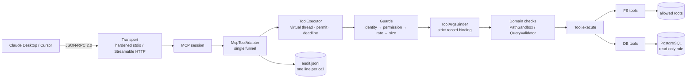

# MCP Developer Tooling Server

A local [Model Context Protocol](https://modelcontextprotocol.io) server that gives
Claude Desktop and Cursor controlled access to a codebase and a PostgreSQL database:
read files, search code, list tables, describe schemas, and run **read-only** SQL.

It is deliberately boring about trust: every call passes through one security funnel
before a tool runs, every terminal outcome is audited, and the database boundary is a
read-only role rather than a regex.

```
9 tools · stdio + Streamable HTTP · 194 tests · 3,831 calls/s at 64 clients
```

- [Quickstart](#quickstart) (Docker: 3 commands; from source: 2)
- [Connect Claude Desktop / Cursor](#connect-claude-desktop--cursor)
- [Architecture](#architecture)
- [Security model](#security-model)
- [Configuration](#configuration)
- [Benchmarks](#benchmarks)
- [Testing](#testing)

## Quickstart

Prerequisites: **Docker**, or **JDK 21 + Maven 3.9** if running from source. No
database is required; FS tools work on their own. PostgreSQL is optional.

### Option A — Docker

From the repository root:

```bash
docker build -t mcp-dev-tooling:0.1.0 .

mkdir -p ~/code/hello
echo "hello from MCP" > ~/code/hello/hello.txt

docker run --rm -i \
  -v "$HOME/code:/workspace:ro" \
  -v mcp-dev-tooling-data:/home/app/.mcp-dev-tooling \
  -e MCP_FS_ROOTS=/workspace \
  mcp-dev-tooling:0.1.0 <<'EOF'
{"jsonrpc":"2.0","id":1,"method":"initialize","params":{"protocolVersion":"2025-11-25","capabilities":{},"clientInfo":{"name":"smoke","version":"0"}}}
{"jsonrpc":"2.0","method":"notifications/initialized"}
{"jsonrpc":"2.0","id":2,"method":"tools/call","params":{"name":"read_file","arguments":{"path":"hello/hello.txt"}}}
{"jsonrpc":"2.0","id":3,"method":"tools/call","params":{"name":"ping","arguments":{}}}
EOF
```

Expected (abridged; order may differ because calls are concurrent):

```json
{"jsonrpc":"2.0","id":1,"result":{"protocolVersion":"2025-11-25","capabilities":{...},"serverInfo":{"name":"mcp-dev-tooling","version":"0.1.0"}}}
{"jsonrpc":"2.0","id":3,"result":{"content":[{"type":"text","text":"pong v0.1.0"}],"isError":false}}
{"jsonrpc":"2.0","id":2,"result":{"content":[{"type":"text","text":"hello from MCP\n"}],"isError":false}}
```

The image runs as UID 10001, not root. The volume keeps the audit log and rolling
server log outside the container.

### Option B — From source

```bash
mvn -q package -DskipTests

mkdir -p demo && echo "hello from MCP" > demo/hello.txt

printf '%s\n' \
  '{"jsonrpc":"2.0","id":1,"method":"initialize","params":{"protocolVersion":"2025-11-25","capabilities":{},"clientInfo":{"name":"smoke","version":"0"}}}' \
  '{"jsonrpc":"2.0","method":"notifications/initialized"}' \
  '{"jsonrpc":"2.0","id":2,"method":"tools/call","params":{"name":"read_file","arguments":{"path":"demo/hello.txt"}}}' \
  '{"jsonrpc":"2.0","id":3,"method":"tools/call","params":{"name":"ping","arguments":{}}}' \
| MCP_FS_ROOTS="$PWD" MCP_AUDIT_FILE=/tmp/mcp-audit.log \
  java -jar target/mcp-dev-tooling-0.1.0.jar
```

That is the whole setup. Logs go to stderr and `~/.mcp-dev-tooling/logs/server.log`;
stdout carries JSON-RPC only.

> `mvn package` with tests is not used here: the integration suite needs Docker.
> Run `mvn verify` for the full suite (see [Testing](#testing)).

## Connect Claude Desktop / Cursor

Point the client at the jar (recommended) or at the Docker image. Absolute paths only.

**Claude Desktop** — `~/Library/Application Support/Claude/claude_desktop_config.json`
(macOS) or `%APPDATA%\Claude\claude_desktop_config.json` (Windows):

```json
{
  "mcpServers": {
    "mcp-dev-tooling": {
      "command": "java",
      "args": ["-jar", "/ABSOLUTE/PATH/TO/MCP-Developer-Tooling/target/mcp-dev-tooling-0.1.0.jar"],
      "env": {
        "MCP_FS_ROOTS": "/Users/you/code/alpha,/Users/you/code/beta",
        "MCP_ROLE": "DEVELOPER"
      }
    }
  }
}
```

**Cursor** — `~/.cursor/mcp.json` (global) or `.cursor/mcp.json` (project):

```json
{
  "mcpServers": {
    "mcp-dev-tooling": {
      "command": "docker",
      "args": [
        "run", "--rm", "-i",
        "-v", "/Users/you/code:/workspace:ro",
        "-v", "mcp-dev-tooling-data:/home/app/.mcp-dev-tooling",
        "-e", "MCP_FS_ROOTS=/workspace",
        "-e", "MCP_ROLE=DEVELOPER",
        "mcp-dev-tooling:0.1.0"
      ]
    }
  }
}
```

Ready-to-edit files: [`client-config/claude_desktop_config.example.json`](client-config/claude_desktop_config.example.json),
[`client-config/cursor.mcp.example.json`](client-config/cursor.mcp.example.json), and
[`client-config/docker.example.json`](client-config/docker.example.json).

Add database access by supplying a read-only role:

```json
"MCP_DB_URL": "jdbc:postgresql://localhost:5432/appdb",
"MCP_DB_USER": "mcp_ro",
"MCP_DB_PASSWORD": "change-me"
```

`MCP_DB_URL` empty means DB tools are advertised but execution fails closed.

Restart the client after editing config. On macOS, quit Claude Desktop fully
(⌘Q) — closing the window does not reload MCP servers.

## Tools

| Tool | Role | What it does | Limits |
| --- | --- | --- | --- |
| `ping` | VIEWER | liveness + server version | — |
| `echo` | VIEWER | echo text, optional repeat | repeat ≤ 50 |
| `time` | VIEWER | current time, optional zone | — |
| `list_dir` | VIEWER | list a directory, depth ≤ 3 | 500 entries |
| `read_file` | VIEWER | read a UTF-8 file | 1 MiB, 2,000 lines |
| `search_code` | VIEWER | literal/regex search across files | 100 matches, 2,000 files, 5 s |
| `list_tables` | VIEWER | schemas/tables from JDBC metadata | filter params bound, never SQL |
| `describe_table` | VIEWER | columns, keys, foreign keys | — |
| `run_query` | **DEVELOPER** | one validated read-only statement | 500 rows, 10 s statement timeout |

Roles are ordered `VIEWER < DEVELOPER < ADMIN`. Permission floors live in code; config
may only raise them, never lower them. Every tool is annotated
`readOnlyHint=true, destructiveHint=false`.

## Architecture



Request path, in order:

1. **Transport** frames one JSON-RPC line (bounded before allocation), maps the
   request id into the call context so cancellation works, and writes responses under
   a lock so concurrent virtual threads cannot interleave bytes.
2. **Executor** registers the call, applies one end-to-end deadline, acquires a permit
   (bounded queue; excess is shed as `DENIED_BACKPRESSURE`), and runs the call on a
   virtual thread.
3. **Guards** deny by default: identity → role → token bucket → argument size.
4. **Binder** maps arguments to a typed record, rejecting unknown/missing/wrong-typed
   fields inside the funnel (so bad calls are audited too).
5. **Domain checks** re-validate the bound arguments: path containment for FS tools,
   SQL structure for `run_query`.
6. **Tool** executes and returns text plus optional structured content.
7. **Audit** writes exactly one JSON line per terminal outcome, including denials,
   timeouts, cancellations and backpressure. A failed audit write denies the call.

Tools never touch transport; transport knows nothing about tool logic. The adapter is
the only bridge.

## Security model

The adversary is the **LLM client**: it can send any tool name, any arguments, any
JSON-RPC frame. It is not assumed to be cooperative.

| Invariant | How it is enforced |
| --- | --- |
| Paths stay inside configured roots | lexical normalization, then real-path containment (`PathSandbox`) |
| Symlink escape is rejected | resolved target must be under a root's real path |
| Files cannot exhaust memory | 1 MiB file cap, line/match/entry caps, bounded stdin line |
| SQL is one read-only statement | single-statement lexer, verb allow-list, no `INTO`, `FOR UPDATE`, `EXPLAIN ANALYZE`, no data-modifying CTEs |
| Writes are impossible even if parsing is bypassed | DB connects as a `SELECT`-only role; session is `TRANSACTION READ ONLY` |
| Queries cannot hang or flood | 10 s statement timeout, 500-row driver cap, pool permit gate |
| Role escalation is impossible from config | code-owned floors; overrides may only narrow (widen = startup failure) |
| Every call is accounted for | append-only JSONL audit; argument values hashed (SHA-256 prefix), never logged |
| Clients never see stack traces | errors are mapped to JSON-RPC codes or tool-level `isError` text |
| stdout is protocol-only | all logging to stderr/file |

Deliberate limits, stated rather than hidden:

- **stdio trust**: the caller identity is a process-wide role from `MCP_ROLE`; stdio
  gives no per-request credential.
- **HTTP profile**: dev-only, loopback, unauthenticated. Do not expose it.
- **SELECT side effects**: parsing cannot see inside functions; the read-only role and
  read-only transaction are the real boundary.
- **TOCTOU**: a local process racing a symlink swap between check and open is out of
  scope (the adversary is the client, not a co-resident process).
- **Unknown tool names** are rejected by the SDK (`-32602`) before the funnel and are
  therefore not audited; schema-invalid arguments to *known* tools are audited.

## Configuration

Every property can be set as an env var (`MCP_FS_MAX_FILE_BYTES` →
`mcp.fs.max-file-bytes`) or a Spring CLI arg
(`--mcp.fs.max-file-bytes=...`). Defaults are shown.

### Filesystem

| Property | Env var | Default | Meaning |
| --- | --- | --- | --- |
| `mcp.fs.roots` | `MCP_FS_ROOTS` | *(empty)* | comma-separated absolute roots; empty disables FS tools |
| `mcp.fs.max-file-bytes` | `MCP_FS_MAX_FILE_BYTES` | `1048576` | per-file read cap |
| `mcp.fs.max-lines` | `MCP_FS_MAX_LINES` | `2000` | lines returned by `read_file` |
| `mcp.fs.max-list-entries` | `MCP_FS_MAX_LIST_ENTRIES` | `500` | `list_dir` entries |
| `mcp.fs.max-list-depth` | `MCP_FS_MAX_LIST_DEPTH` | `3` | `list_dir` recursion |
| `mcp.fs.max-search-matches` | `MCP_FS_MAX_SEARCH_MATCHES` | `100` | `search_code` matches |
| `mcp.fs.max-search-files` | `MCP_FS_MAX_SEARCH_FILES` | `2000` | files scanned |
| `mcp.fs.max-search-file-bytes` | `MCP_FS_MAX_SEARCH_FILE_BYTES` | `524288` | files larger than this are skipped |
| `mcp.fs.max-search-line-length` | `MCP_FS_MAX_SEARCH_LINE_LENGTH` | `1000` | per-line match cap |
| `mcp.fs.max-query-length` | `MCP_FS_MAX_QUERY_LENGTH` | `512` | search query length cap |
| `mcp.fs.search-deadline-millis` | `MCP_FS_SEARCH_DEADLINE_MILLIS` | `5000` | search wall-clock budget |
| `mcp.fs.ignore` | `MCP_FS_IGNORE` | `.git,node_modules,target,…` | pruned directory names |

### Database

| Property | Env var | Default | Meaning |
| --- | --- | --- | --- |
| `mcp.db.url` | `MCP_DB_URL` | *(empty)* | JDBC URL; empty disables execution |
| `mcp.db.username` | `MCP_DB_USER` | *(empty)* | **use a read-only role** |
| `mcp.db.password` | `MCP_DB_PASSWORD` | *(empty)* | password |
| `mcp.db.max-pool-size` | `MCP_DB_MAX_POOL_SIZE` | `5` | pool and concurrency gate |
| `mcp.db.query-timeout-seconds` | `MCP_DB_QUERY_TIMEOUT_SECONDS` | `10` | statement timeout |
| `mcp.db.max-rows` | `MCP_DB_MAX_ROWS` | `500` | driver-side row cap |
| `mcp.db.max-render-rows` | `MCP_DB_MAX_RENDER_ROWS` | `50` | rows in the text table |
| `mcp.db.max-cell-length` | `MCP_DB_MAX_CELL_LENGTH` | `120` | cell truncation |

### Security and execution

| Property | Env var | Default | Meaning |
| --- | --- | --- | --- |
| `mcp.security.role` | `MCP_ROLE` | `VIEWER` | `VIEWER`/`DEVELOPER`/`ADMIN`; unknown value fails startup |
| `mcp.security.permission-overrides` | — | `{}` | per-tool floor; CLI only: `--mcp.security.permission-overrides.[run_query]=ADMIN` |
| `mcp.security.rate-limit-capacity` | `MCP_RATE_LIMIT_CAPACITY` | `30` | burst per (identity, tool) |
| `mcp.security.rate-limit-refill-per-second` | `MCP_RATE_LIMIT_REFILL` | `10` | sustained rate |
| `mcp.security.max-args-bytes` | `MCP_SECURITY_MAX_ARGS_BYTES` | `65536` | serialized argument cap |
| `mcp.security.audit-file` | `MCP_AUDIT_FILE` | `~/.mcp-dev-tooling/audit.log` | JSONL audit path |
| `mcp.executor.max-concurrent-calls` | `MCP_MAX_CONCURRENT_CALLS` | `2048` | in-flight + queued ceiling |
| `mcp.executor.queue-wait-millis` | `MCP_QUEUE_WAIT_MILLIS` | `5000` | wait before shedding |
| `mcp.executor.call-timeout-millis` | `MCP_CALL_TIMEOUT_MILLIS` | `30000` | end-to-end deadline |
| `mcp.executor.stats-interval-seconds` | `MCP_STATS_INTERVAL_SECONDS` | `0` | executor gauges to stderr (0 = off) |
| `mcp.transport.max-line-chars` | `MCP_MAX_LINE_CHARS` | `1048576` | inbound JSON-RPC line cap |
| `mcp.transport.mode` | — | `stdio` | `stdio` or `http` (HTTP also needs `--spring.profiles.active=http`) |
| `server.port` | `MCP_HTTP_PORT` | `8080` | HTTP profile only |

### HTTP profile (optional)

```bash
java -jar target/mcp-dev-tooling-0.1.0.jar --spring.profiles.active=http
# MCP endpoint: http://127.0.0.1:8080/mcp
```

Binds to loopback by design; unauthenticated; intended for local tools that cannot
spawn a process. stdio remains the default and the recommended path.

## Benchmarks

Measured with [`bench/run_bench.py`](bench/run_bench.py) on a 12-core Intel
i5-1235U, 6.9 GB RAM, OpenJDK 21.0.12.1, PostgreSQL 16 in Docker, three runs of
10,000 calls at 64 concurrent clients after 500 warmup calls:

| Metric | Result (median, range over 3 runs) |
| --- | --- |
| Throughput, 64 concurrent clients | **3,831 calls/s** (3,468–4,036) |
| Latency p50 / p95 / p99 | 13.2 ms / 22.6 ms / **46.4 ms** (p99 range 45.0–71.8) |
| Throughput, serial client | 868 calls/s (819–875) |
| Serial latency p50 / p99 | 1.06 ms / 2.53 ms |
| Audit completeness | 10,500 / 10,500 lines per run, all `OK` |
| Peak RSS / threads / fds under load | 223 MiB / 45 / 10 |
| Backpressure (1 permit, 50 ms queue wait) | 199 / 200 shed, 200 audit lines |
| Cancellation acknowledgement | 21.5–38.4 ms after `notifications/cancelled` |
| 2,000 ms deadline | response in 2,059–2,083 ms; audit `TIMEOUT` |

Method, raw JSON and caveats: **[BENCHMARKS.md](BENCHMARKS.md)**. Reproduce:

```bash
mvn -q package -DskipTests
docker run --rm -d --name mcp-bench-pg -p 55432:5432 \
  -e POSTGRES_USER=bench -e POSTGRES_PASSWORD=bench -e POSTGRES_DB=bench postgres:16-alpine
python3 bench/run_bench.py \
  --jar target/mcp-dev-tooling-0.1.0.jar \
  --db-url jdbc:postgresql://localhost:55432/bench --db-user bench --db-password bench
```

These are laptop numbers on a shared OS; use them for relative comparison and
regression tracking, not as a capacity promise.

## Testing

| Command | What runs | Needs Docker |
| --- | --- | --- |
| `mvn test` | 162 unit tests (JUnit 5 + Mockito) | no |
| `mvn verify` | + 32 integration tests + coverage gates | yes |

Integration tests use Testcontainers PostgreSQL and drive the packaged jar over stdio
as a black box. Every security invariant maps to at least one test; mutation
evidence for the four core boundaries is recorded in [TESTING.md](TESTING.md). CI: GitHub Actions, unit job plus a
`mvn verify` job with JaCoCo gates.

## Project layout

```
src/main/java/com/mcpdev/tooling/
  transport/     hardened stdio, HTTP profile, error mapping
  protocol/      JSON-RPC constants and request context
  registry/      Tool contract, binder, schemas, McpToolAdapter (the funnel)
  executor/      virtual-thread executor, permits, deadlines, cancellation
  security/      PathSandbox, QueryValidator, guards, permissions, audit
  tools/fs/      list_dir, read_file, search_code
  tools/db/      DbClient, list_tables, describe_table, run_query
  config/        Spring configuration and typed properties
bench/           reproducible benchmark harness + raw result JSON
client-config/   Claude Desktop / Cursor examples
```

## Troubleshooting

| Symptom | Cause and fix |
| --- | --- |
| `Filesystem tools are disabled` | `MCP_FS_ROOTS` is empty or relative — use absolute paths |
| `denied: tool 'run_query' requires role DEVELOPER` | set `MCP_ROLE=DEVELOPER` (or `ADMIN`) |
| Startup fails with `unknown role` | valid roles are `VIEWER`, `DEVELOPER`, `ADMIN` |
| Startup fails with `would WIDEN` | a permission override tried to lower a code-owned floor |
| Client shows no tools | check stderr; stdout must be JSON-RPC only, config must use absolute paths |
| `connection refused` / DB errors | verified role, grants, host/port; the role needs `SELECT` only |
| Container cannot write the audit log | mount a volume at `/home/app/.mcp-dev-tooling` or set `MCP_AUDIT_FILE` to a writable path |
| Client config not reloaded | restart the client; on macOS quit Claude Desktop with ⌘Q |
